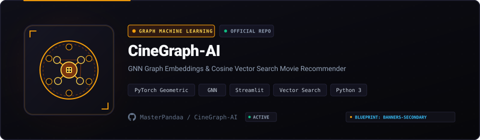

<p align="center">
  
</p>

<p align="center">
  <a href="#architecture"></a>
  <a href="#quickstart"></a>
  <a href="#quickstart"></a>
  <a href="LICENSE"></a>
</p>

## Overview

Traditional collaborative filtering models compute user-item interactions through sparse matrix factorization, missing non-linear graph relationships across genres, directors, and latent thematic clusters. CineGraph AI models multi-relational film connectivity using **Graph Neural Networks (GNN)**, mapping complex film topologies into a continuous dense vector space.

Pre-trained node embeddings (`movie_gnn_model.pkl`) run inside an interactive **Streamlit** dashboard, delivering sub-millisecond similarity lookups and real-time persona simulation directly in memory.

---

## Core Capabilities

- **Graph Topology Embeddings**: Encodes relational multi-hop film connections instead of relying solely on keyword matching.
- **Dynamic Centroid Profiling**: Computes a dynamic user taste vector by calculating the centroid (`np.mean`) across selected watch histories.
- **Vector Cosine Search**: Evaluates cosine similarity against the full catalog vector space in sub-millisecond retrieval times.
- **Deduplication Engine**: Automatically filters previously selected titles out of candidate recommendation pools.
- **In-Memory Model Caching**: Leverages Streamlit resource caching to maintain instant response times during repeated queries.

---

## Architecture Flow

```text
User Watch History
       │
       ▼
Centroid Vector Computation ──► np.mean([Emb_1, Emb_2, ...])
       │
       ▼
Cosine Proximity Search    ──► Dot product against pre-trained GNN matrix
       │
       ▼
Deduplication & Top-K Rank ──► Filter watched titles & return nearest film nodes
```

---

## Quickstart

### Prerequisites

- Python 3.9 or higher
- pip and virtualenv

### Setup and Execution

1. Clone the repository:
   ```bash
   git clone https://github.com/MasterPandaa/CineGraph-AI.git
   cd CineGraph-AI
   ```

2. Create and activate a virtual environment:
   ```bash
   # Windows PowerShell
   python -m venv venv
   .\venv\Scripts\Activate.ps1

   # Linux / macOS
   python3 -m venv venv
   source venv/bin/activate
   ```

3. Install dependencies:
   ```bash
   pip install -r requirements.txt
   ```

4. Launch the application:
   ```bash
   streamlit run app.py
   ```
   Open `http://localhost:8501` in your browser.

---

## Repository Structure

```text
CineGraph-AI/
├── app.py                  # Streamlit application interface and recommendation engine
├── requirements.txt        # Pinned Python package dependencies
├── movie_gnn_model.pkl     # Serialized GNN node embeddings and catalog metadata
├── Procfile                # Production deployment configuration
└── README.md               # Architecture documentation
```

---

## License

This project is licensed under the [MIT License](LICENSE).
